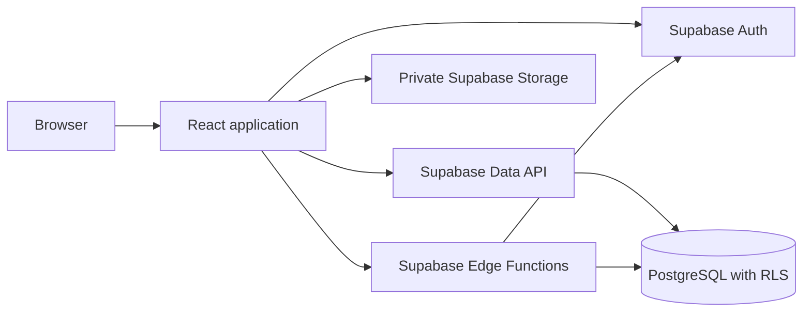

# Diocese of Kigezi Human Resource Management Information System (DHRMIS)

DHRMIS is a browser based human resource management system for the Diocese of Kigezi. It manages employee records and their assignments, organizational structure, recruitment, staff development, benefits, sensitive personnel matters, documents, and system access. The application is built with React and TypeScript and uses Supabase for authentication, PostgreSQL data, file storage, and server side administrative operations.

This document explains how the code is arranged, how the main requests move through the system, and how to configure and extend it. For first administrator provisioning and historical workspace migration checks, see [Administrator onboarding](docs/ADMIN_ONBOARDING.md).

## Contents

- [System architecture](#system-architecture)
- [Repository map](#repository-map)
- [Application startup and request flow](#application-startup-and-request-flow)
- [Roles and workspaces](#roles-and-workspaces)
- [Functional areas](#functional-areas)
- [Supabase database and security](#supabase-database-and-security)
- [Edge Functions](#edge-functions)
- [Configuration](#configuration)
- [Run locally](#run-locally)
- [Build and maintain](#build-and-maintain)
- [Adding a feature](#adding-a-feature)

## System architecture



The React application is the user interface and calls Supabase using the public publishable key (or the legacy anon key). PostgreSQL Row Level Security (RLS) policies determine which rows the signed in user can read or change. Private document and profile photo access is controlled by Storage policies and short lived signed URLs. Edge Functions perform operations that need trusted server side credentials, such as account administration and password changes.

The frontend's route and role checks control navigation and presentation. They are not the security boundary: protected data access must still pass the database and Storage policies. Do not add a service role key or other privileged secret to a `VITE_` variable, because Vite includes `VITE_` values in browser code.

## Repository map

| Path | Responsibility |
| --- | --- |
| `src/main.tsx` | React entry point; installs routing, providers, global styles, and the production service worker. |
| `src/app/App.tsx` | Authenticated application shell, route selection, workspace guard, sidebars, global search, notifications, and lazy loaded pages. |
| `src/app/modules.ts` | Configuration for data backed pages: route, label, table, columns, form fields, and frontend role rules. |
| `src/app/ModulePage.tsx` | Shared list and form screen used by many configured HR, administration, and operational routes. |
| `src/app/DashboardPage.tsx`, `WorkspaceDashboardCharts.tsx` | Workspace dashboards and personnel summary views. |
| `src/components/` | Reusable navigation, tables, forms, icons, theme controls, and confirmation/feedback UI. |
| `src/modules/` | Feature specific pages, types, and services. Examples include `admin`, `auth`, `human-resources`, `archive`, `death`, and `profile`. |
| `src/modules/core/auth/context.tsx` | Shared authentication context. Restores the Supabase session, records it, and loads the current role and workspace. |
| `src/core/` | Cross feature services for Supabase configuration, scope resolution, audit, documents, search, errors, notifications, monitoring, and theme. |
| `src/types/` | Shared TypeScript domain definitions, re-exported by `src/types/index.ts`. |
| `supabase/migrations/` | Ordered PostgreSQL schema, policy, function, trigger, and data migration history. |
| `supabase/functions/` | Deno based Supabase Edge Functions for trusted account and profile operations. |
| `supabase/tests/security/` | SQL checks for workspace isolation and employee lifecycle privileges. |
| `supabase/seed.sql` | Seed data used by configured local Supabase database resets. |
| `docs/ADMIN_ONBOARDING.md` | Trusted first administrator setup and workspace migration guidance. |
| `public/` | App icons, PWA manifest, and service worker. |

### Shared application services

- `src/core/config/index.ts` constructs the Supabase browser client from the environment and documents the RLS expectations for protected data.
- `src/core/organizational-scope/workspaces.ts` defines the Secretariat and Board workspaces, their slugs, role codes, navigation, and frontend workspace helpers.
- `src/core/audit/` contains audit query helpers, sensitive-read logging, and frontend audit policy metadata. Row change audit records are generated by database triggers; the browser service rejects direct writes to the audit log.
- `src/core/documents/documentService.ts` validates upload type and size, creates a storage path and checksum, writes document metadata, cleans up a file if metadata saving fails, and creates signed download URLs.
- `src/core/search/search.ts` performs role-aware employee, assignment, and document search. Database RLS still controls returned rows.
- `src/core/errors/`, `src/core/notifications/`, `src/core/monitoring/`, and `src/core/theme/` provide shared error boundaries, toast messages, connectivity status, and theme state.

## Application startup and request flow

1. `src/main.tsx` mounts the React app under `BrowserRouter`, `ThemeProvider`, `AuthProvider`, `ToastProvider`, and an error boundary. It adds routes for sign-in and password recovery and sends other paths into the main application shell.
2. `AuthProvider` restores the Supabase session, tracks auth state changes, records the current sign-in in `user_sessions`, and calls the database `get_current_workspace()` RPC to resolve an active role and personnel domain.
3. `src/app/App.tsx` redirects signed out users to `/login`, requires first-login password changes when the auth metadata flag is set, and sends the user to their assigned workspace. It loads feature pages lazily and selects a sidebar for the account's role.
4. For configured screens, `src/app/modules.ts` supplies a `ModuleConfig`. `ModulePage` uses the config to render a table and form, query the configured Supabase table, load lookup choices, search and paginate results, and submit supported changes. More involved screens use dedicated components, for example employee profiles, dashboards, document management, death records, and administration.
5. Supabase evaluates the caller's JWT and the relevant database or Storage policies. Migrations also install database functions and triggers for high risk workflows, workspace resolution, and audit history.

The application uses lazy loaded routes to keep feature code out of the initial bundle when it is not needed. It registers `public/service-worker.js` in production. That worker caches the static app shell and assets; it intentionally does not cache Supabase Auth, REST, or Storage requests. When disconnected, the UI warns that protected records are unavailable and that changes are not queued.

## Roles and workspaces

There are seven personnel workspaces and one platform administration role:

| Role code | Workspace |
| --- | --- |
| `SECRETARIAT_USER` | Secretariat / Main Office |
| `MISSION_BOARD_USER` | Mission Board |
| `EDUCATION_BOARD_USER` | Education Board |
| `HEALTH_BOARD_USER` | Health Board |
| `LAND_FINANCE_BOARD_USER` | Land & Finance Board |
| `PLANNING_DEVELOPMENT_BOARD_USER` | Planning & Development Board |
| `ICT_BOARD_USER` | ICT Board |
| `SUPER_SYSTEM_ADMIN` | Platform user, security, audit, sessions, and system configuration |

Business accounts are assigned to a single personnel domain. The database RPC returns the resolved role/domain, and workspace helpers map that result to the frontend navigation. Secretariat manages the diocesan structure, including archdeaconries, parishes, and local churches. Board accounts manage personnel in their Board domain. The Super/System Administrator operates the platform and has no departmental employee workspace.

The frontend role helpers in `src/app/modules.ts` restrict available routes and actions. For example, the platform administrator paths are reserved for `SUPER_SYSTEM_ADMIN`, finance routes require the Land & Finance Board role, and Secretariat alone can manage archdeaconries, parishes, and local churches. Database RLS policies independently enforce personnel domain and record access. Treat any change to role or scope logic as a coordinated frontend and database security change.

## Functional areas

The route definitions in `src/app/modules.ts` describe most configured screens. The workspace sidebars in `src/components/navigation/sibarRoles/` determine which links are shown to each kind of user.

| Area | Examples |
| --- | --- |
| Employee records | People directory, clergy, catechists, employee profile, family/next of kin |
| Assignments and organization | Assignments, employee transfers, employee roles, acting appointments, departments, institutions, positions, grades, diocesan hierarchy |
| Development and service | Leave, qualifications, training, professional licences/certifications, performance, appointments and promotions |
| Recruitment | Vacancies, applicants, and recruitment applications |
| Finance and benefits | Payroll, benefits, pension membership/contributions, retirement, and early retirement |
| Governance and sensitive records | Discipline, safeguarding, and death reporting/verification |
| Community and planning | Welfare, housing/property, and succession planning |
| Documents | Document registry and private file upload/download |
| Platform administration | User access, scopes, role permissions, sessions, audit, security events, administrative reports, monitoring, and settings |

Some pages are implemented as standalone React components rather than as a generic `ModulePage` table. Read the feature directory and its service code before changing those flows.

## Supabase database and security

### Migration structure

Migrations are applied in timestamp order. The initial migrations establish core security and users, organizational hierarchy, employee master records, assignments, role records, personal/family data, professional development, leave, performance, appointments, payroll, pension, retirement, discipline, documents, recruitment, welfare/housing, succession, and system configuration.

Later migrations add or refine RLS, private storage, notifications, personnel-domain isolation, canonical workspace roles, the platform-only administrator boundary, current workspace and administration RPCs, session management, first-login password handling, private profile photos, self-service profile operations, audit change values, and dashboard analytics. Because these are incremental schema changes, apply the entire migration history to a new Supabase project rather than selecting only the initial schema files.

`supabase/config.toml` configures local Supabase services, database migrations and seed file, Auth settings, and function JWT verification. `supabase/tests/security/` contains SQL security scenarios; use them when changing RLS or privileged database functions.

### Access controls

- **Authentication:** Supabase Auth owns credentials and browser sessions. `src/modules/core/auth/context.tsx` tracks the signed in user and the application session record.
- **Role and workspace resolution:** `get_current_workspace()` is the database API used to resolve the user's current active role and domain.
- **Row security:** PostgreSQL RLS policies and helper functions such as `can_manage_personnel_domain` and `can_access_employee` constrain data by role, session status, and personnel domain. A hidden link or route is not sufficient protection.
- **Sensitive reads:** The frontend records reads for configured sensitive categories, while RLS determines whether the database can accept that log entry. Audit and security events are available through restricted platform administration screens.
- **Audit history:** Database triggers create row change audit entries. Migrations define redaction and change-value capture so credentials and other protected values are not copied into audit history.
- **Files:** Documents use a private bucket configured by `VITE_HR_DOCUMENTS_BUCKET`; the application uses signed URLs rather than public object URLs. Profile photos use a separate private `profile-photos` bucket and per-user Storage policies.
- **Privileged operations:** Edge Functions use server-side Supabase credentials after validating the caller. Those secrets must remain in Supabase's server-side environment.

The MFA migration names reflect the migration history; use the currently applied configuration and policies as the source of truth rather than inferring the live sign-in policy from an older migration filename.

## Edge Functions

Functions are under `supabase/functions/<function-name>/index.ts` and are invoked by the frontend through Supabase Functions. `supabase/config.toml` enables JWT verification for the account and self-service functions.

| Function | Purpose |
| --- | --- |
| `register-user` | Creates a named account for a designated role, generates a one-time temporary password, assigns access, and marks the account to change its password at first sign-in. |
| `admin-user-account` | Performs privileged account changes such as password reset/account removal and related audit handling, after validating the Super/System Administrator caller. |
| `complete-first-login-password` | Completes the required first-login password change and clears the auth metadata requirement. |
| `change-own-password` | Handles a signed-in user's password change through a trusted server-side auth admin client. |
| `self-service-email` | Changes the signed-in user's email and records the corresponding account activity. |
| `update-own-profile` | Updates supported self-service profile details and records the change. |

When changing a function, preserve caller identity validation and role/session checks. Do not move service-role operations into browser code.

## Configuration

Copy `.env.example` to `.env` and set the browser-side Supabase values:

```dotenv
VITE_SUPABASE_URL=https://<project-ref>.supabase.co
VITE_SUPABASE_PUBLISHABLE_KEY=<publishable-key>
VITE_HR_DOCUMENTS_BUCKET=hr-documents
```

The application also accepts `VITE_SUPABASE_ANON_KEY` as a legacy alternative to `VITE_SUPABASE_PUBLISHABLE_KEY`. Do not set both unless you have a specific reason. `VITE_HR_DOCUMENTS_BUCKET` is required for document upload/download. The browser should contain only public client configuration; configure `SUPABASE_SERVICE_ROLE_KEY` and other trusted secrets in the Supabase Edge Function environment, never in `.env` values with a `VITE_` prefix.

The sample file also lists `VITE_APP_NAME`, `VITE_APP_ENV`, SMTP, and break-glass placeholders. The first two are not currently read by the frontend; the page title and app name are set in `index.html`. SMTP and break-glass values are not needed for normal browser operation. Add server-only values only when a corresponding server-side feature is configured, and do not commit real credentials.

## Run locally

Prerequisites: Node.js/npm and the Supabase CLI. A Supabase project is required for authenticated data flows.

```powershell
npm ci
Copy-Item .env.example .env
# Edit .env with the Supabase URL and public key
npm run dev
```

Vite serves the frontend at `http://127.0.0.1:5173`. Without Supabase configuration the app can load, but sign-in and database backed features will not work.

To use the local Supabase stack, start it with the Supabase CLI, then apply the project's migrations and seed data:

```powershell
supabase start
npm run migrate:local
```

For a remote project, first link the intended project with the Supabase CLI, review the pending migrations, and then run `npm run migrate`. Follow [Administrator onboarding](docs/ADMIN_ONBOARDING.md) to provision the initial platform administrator. There is deliberately no public admin bootstrap flow.

## Build and maintain

Available package scripts:

| Command | Description |
| --- | --- |
| `npm run dev` | Start the Vite development server. |
| `npm run build` | Type-check with TypeScript and create the production Vite bundle in `dist/`. |
| `npm run type` | Run TypeScript without emitting output. |
| `npm run lint` | Run ESLint over the repository. |
| `npm test` | Run the Vitest suite. |
| `npm run migrate` | Apply migrations to the linked Supabase project. |
| `npm run migrate:local` | Apply migrations to the local Supabase project. |
| `npm run generate-types` | Generate TypeScript definitions from the configured Supabase project schema. |

Vite aliases `@` to `src`, and TypeScript is configured in strict mode. Feature and core utilities may have colocated Vitest files, while database security scenarios live under `supabase/tests/security/`.

## Adding a feature

For a standard table/form route:

1. Add a `ModuleConfig` entry in `src/app/modules.ts` with its path, label, table, displayed columns, form fields, and any lookup/filter/default settings.
2. Add or update the feature's TypeScript types in `src/types/` or the relevant `src/modules/<feature>/types/` directory.
3. Add a timestamped SQL migration for schema changes. Include appropriate RLS policies, constraints, and database audit behavior in that migration.
4. Add the route to the appropriate role sidebar in `src/components/navigation/sibarRoles/` and confirm both frontend module role rules and database policies agree.
5. For a multi-step workflow, custom data presentation, or privileged operation, implement a dedicated module page/service or Edge Function instead of forcing it into the generic form configuration.
6. Add coverage for the changed behavior, especially SQL security cases when data scope or permissions change.

Do not rely on a frontend-only filter to protect personnel data. Every new table or storage path containing confidential records needs database or Storage policies before it is exposed to the client.
